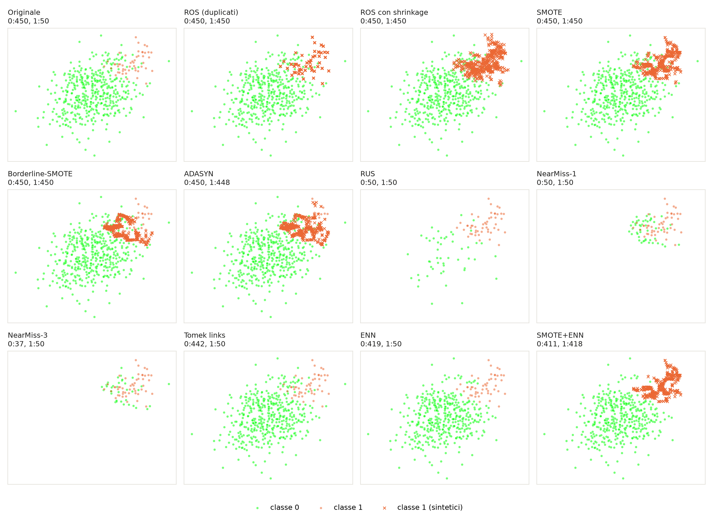

# Metodi per dataset sbilanciati con imbalanced-learn
**applicazione e confronto dei principali metodi della libreria
[imbalanced-learn](https://imbalanced-learn.org/stable/index.html) su 5 dataset
reali fortemente sbilanciati**.

---

## 1. Di cosa si tratta

### Il problema
Un dataset è **sbilanciato** quando una classe è molto più rara delle altre:
frodi bancarie, malattie, guasti. Un classificatore addestrato su questi dati
impara a rispondere sempre con la classe frequente. Nei nostri esperimenti la
regressione logistica su **Abalone 19** ha accuratezza **0,992** ma **G-mean 0**:
non trova nessun caso raro.

### Cosa si usa di imbalanced-learn

| Famiglia | Idea | Metodi usati |
|---|---|---|
| **Oversampling** | aggiungere campioni alla classe rara | RandomOverSampler, SMOTE, Borderline-SMOTE, ADASYN, SMOTE-NC |
| **Undersampling** | togliere campioni alla classe frequente | RandomUnderSampler, NearMiss-1 |
| **Pulizia** | togliere i campioni ambigui sul confine | Tomek links, Edited Nearest Neighbours |
| **Combinati** | oversampling + pulizia | SMOTE+ENN, SMOTE+Tomek |

Anche la metrica G-mean viene dalla libreria (`imblearn.metrics`).

### I dataset

I 5 dataset scelti sono casi reali di classificazione fortemente sbilanciata. Vengono scaricati in automatico al primo avvio da due note raccolte pubbliche:
- **[Benchmark di imbalanced-learn](https://imbalanced-learn.org/stable/references/generated/imblearn.datasets.fetch_datasets.html)** (Ding 2011): una raccolta di riferimento nella letteratura scientifica sul learning sbilanciato. Da qui provengono *Satimage* e *Mammography*.
- **[OpenML](https://www.openml.org/)**: utilizzato per recuperare *Abalone 19*, *Page Blocks* e *Bank Marketing*. L'uso di OpenML è fondamentale perché permette di scaricare i dati mantenendo intatte le colonne categoriche con i loro valori originali (non ancora convertite in one-hot). Questo è un requisito strettamente necessario per poter valutare correttamente il comportamento di algoritmi per dati misti come SMOTE-NC.

| Dataset | Dominio | Campioni | Casi rari | Sbilanciamento | Categoriche |
|---|---|---|---|---|---|
| [Satimage](https://archive.ics.uci.edu/dataset/146/statlog+landsat+satellite) | immagini satellitari | 6.435 | 626 (9,7%) | 9,3 : 1 | — |
| [Mammography](https://www.openml.org/d/310) | diagnosi medica | 11.183 | 260 (2,3%) | 42 : 1 | — |
| [Abalone 19](https://archive.ics.uci.edu/dataset/1/abalone) | biologia marina | 4.177 | 32 (0,8%) | 130 : 1 | sesso |
| [Page Blocks](https://archive.ics.uci.edu/dataset/78/page+blocks+classification) | documenti scansionati, 5 classi | 5.473 | da 329 a 28 | fino a 175 : 1 | — |
| [Bank Marketing](https://archive.ics.uci.edu/dataset/222/bank+marketing) | clienti di una banca | 45.211 | 5.289 (11,7%) | 7,5 : 1 | 9 su 15 |
---

## 2. Struttura del progetto

```
experiments/
  common.py                dataset, elenco dei metodi, protocollo di cross-validation
  run_experiments.py       esperimento principale
  visualizza_2d.py         figura didattica 2D
  grafici_relazione.py     grafici di RELAZIONE.md
  plots.py                 funzioni per i grafici
results/                   output degli esperimenti (CSV, tabelle .md, PNG)
requirements.txt           librerie con le versioni usate
```

---

## 3. Installazione ed esecuzione

Serve Python 3.10+ e, al primo avvio, internet per scaricare i dataset.

```bash
python -m venv .venv
```

```bash
.venv\Scripts\activate
```

```bash
pip install -r requirements.txt
```

```bash
python experiments/run_experiments.py
```

```bash
python experiments/grafici_relazione.py
```

```bash
python experiments/visualizza_2d.py
```

L'esperimento principale dura circa 7 minuti.

---

## 4. Protocollo e risultati principali

**Protocollo**: cross-validation stratificata 5-fold ripetuta 2 volte; il
ricampionamento è applicato **solo al training set di ogni fold**. Classificatori:
regressione logistica, albero di decisione, k-NN. Metriche: accuracy, balanced
accuracy, F1 macro, G-mean, ROC-AUC.

**Risultati** (tabelle complete in [results/riepilogo.md](results/riepilogo.md),
heatmap in `results/heatmap_*.png`):

- Senza ricampionamento la G-mean crolla (0,130 su Satimage, 0 su Abalone 19 con
  la regressione logistica) mentre l'accuratezza resta sopra il 90%.
- In media sui 15 casi dataset × classificatore vince **RUS** (G-mean 0,775),
  seguito da **SMOTE+ENN** (0,757); senza ribilanciamento 0,507. Il migliore
  cambia da caso a caso.
- Con pochissimi casi rari (Abalone 19) l'oversampling fatica con albero e kNN,
  mentre l'undersampling regge meglio.
- **Tomek ed ENN da soli non bastano**: tolgono pochi campioni e lo squilibrio resta.
- **NearMiss-1** è spesso il peggiore tra i metodi bilancianti.
- Sui dataset con colonne categoriche **SMOTE-NC** è l'unico oversampler che non
  inventa categorie.


